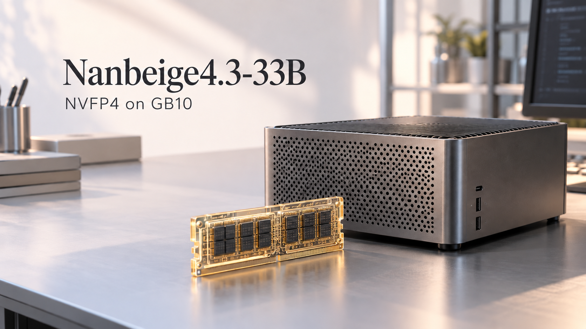
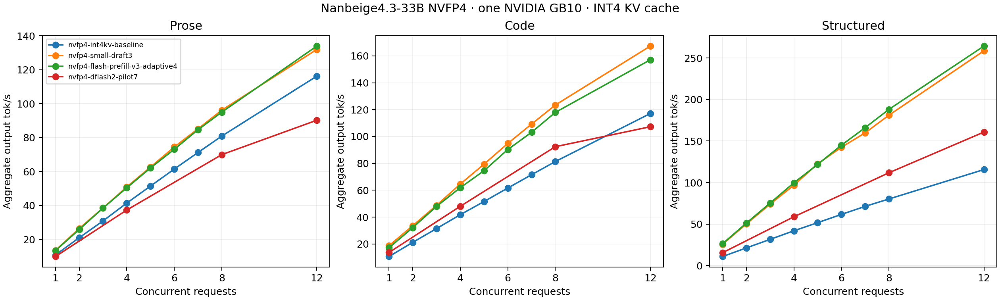
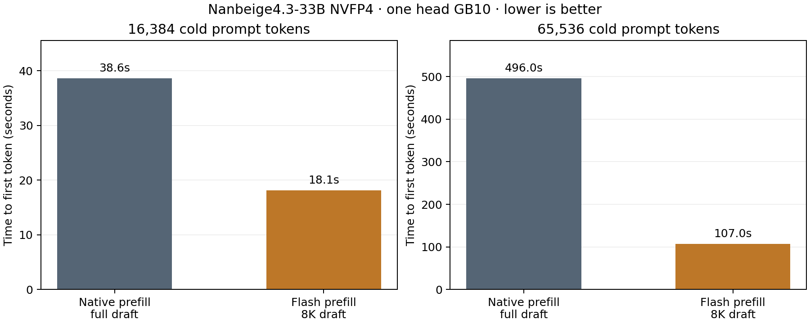

# Nanbeige4.3-33B NVFP4 on GB10



A tested single-GB10 recipe combining the 33B NVFP4 target with a smaller
pretrained NVFP4 draft, native B12X linear kernels, Triton INT4 KV cache, and
an OpenAI-compatible API. The target verifies the draft's proposals. Both
models run on the same Spark; serving needs no second machine.

| Setting | Value |
| --- | --- |
| Hardware | One NVIDIA GB10, 128 GB unified system memory |
| Target | `primitive-ai/Nanbeige4.3-33B-NVFP4` |
| Draft source | `kaitchup/Nanbeige4.1-3B-NVFP4` |
| Downloads | 22.09 GB target + 3.46 GB draft source; pinned revisions and SHA-256 |
| Concurrent request slots | 12 |
| Maximum context per request | 262,144 tokens |
| Shared KV allocation | 74 GiB across target and draft, INT4 per token and head |
| Engine-reported target cache capacity | 1,073,952 tokens |
| Draft context window | 8,192 tokens; target retains 262K |
| Default speculation | Adaptive, 1–4 draft tokens, initial 2, observation window 4 |
| Linear / attention backends | B12X / Triton |
| Prefill chunk budget | 4,096 tokens |
| Reasoning / tool parsers | `qwen3` / `qwen3_coder`, XML tool format |

The cache is shared across requests, with capacity for about 4.10 full-context
requests. Twelve slots do not each receive a separate 262K cache. The exact
selected speculation and graph settings are in [the pinned profile](profiles/nvfp4.json).

The `nvfp4-code` reference holds the draft budget at three tokens. It measured
18.73 output tokens/s for C1 code and 167.31 for C12 code with the base image and
a full-attention draft. The default adds the FlashAttention prefill build and an
explicit 8K draft attention window. Both use the same context, concurrency, and
cache allocation. Their container names and cache subdirectories are separate.

## Measured performance

| Workload | C1 tok/s | C8 aggregate tok/s | C12 aggregate tok/s | C12 vs no-draft baseline |
| --- | ---: | ---: | ---: | ---: |
| Prose | 13.32 | 94.95 | 133.94 | 1.15× |
| Code | 17.21 | 117.94 | 157.11 | 1.34× |
| Structured | 26.32 | 188.13 | 264.41 | 2.29× |



The [full tables](results/SUMMARY.md) and raw JSON cover prose, code, and
schema-constrained JSON. The selected profile is measured at every concurrency
from C1 through C8, plus C12. The comparison uses aggregate output tokens per
second, including prefill and request overhead. Thinking is off, temperature
is zero, and each request has a unique prompt-cache salt. Prose and code use
128 generated tokens; JSON runs to a complete, semantically checked document.
Single-pass results have normal measurement variability.

Serving runs retain the host's existing 2,000 MHz GPU cap, with 1,989 MHz observed,
and the CPU performance governor. The launcher does not alter host clocks.
[Hardware](results/hardware.json), [runtime versions](results/runtime-versions.json),
and [candidate settings](results/configurations.json) are retained.

A DFlash2 pilot was trained using the second GB10 and tested on this one. It
passed the functional checks but was slower than the pretrained quantized
draft. GPU n-gram lookup produced intermittent structured-output errors and
was rejected. See [the experiment notes](docs/experiments.md) for methods,
results, and limitations.

Cold-prefill measurements and full-context capacity evidence are in
[PREFILL.md](results/PREFILL.md). The primary throughput figures use greedy
sampling; [production-default measurements](results/nvfp4-production-defaults.json)
also cover C1 and C12 at temperature 0.6 and top-p 0.95. Draft acceptance and
throughput depend on sampling, prompt content, and context length.



## Run

Use a Linux aarch64 GB10 with the NVIDIA container runtime and at least 104 GiB
available unified memory before loading. Weights and compiled caches stay
outside Git. Both downloads are resumable and verify every file's SHA-256.

```bash
docker build -t nanbeige43-gb10-nvfp4:20261025 .
python3 tools/download.py nvfp4 --output ./models/nvfp4
python3 tools/download.py draft-source --output ./models/draft-source
python3 tools/adapt_draft.py \
  --source-dir ./models/draft-source --target-dir ./models/nvfp4 \
  --output ./models/draft
python3 tools/serve.py nvfp4 \
  --model-dir ./models/nvfp4 --draft-dir ./models/draft
curl -f http://127.0.0.1:8000/health
curl -f http://127.0.0.1:8000/v1/models
```

The draft requires 768 unused vocabulary rows to match the target's padded
vocabulary. The adaptation checks exact token-ID equivalence, preserves all
963 original tensor payloads, and reads back the output to verify preservation
and zero padding. It keeps the original download unchanged. The retained
[adaptation record](results/draft-adaptation.json) includes payload hashes.
All 32 draft layers explicitly use sliding attention. The hybrid cache manager
is disabled to retain the validated shared allocation while saving draft
attention compute outside the 8K window. Adaptive speculation uses the V1
runner's PIECEWISE graph mode in this pinned runtime.

To reproduce the older fixed-three reference, generate a separate draft using
`tools/adapt_draft.py --full-attention` with the same source and target arguments,
and a new output directory. Serve it with the `nvfp4-code` profile and that
directory as `--draft-dir`.

The launcher refuses to start if the GPU or chosen port is occupied. It stops
no other containers and waits until the model is ready. Keep the cache directory
between starts so kernel compilation and tuning results survive. Follow logs
with `docker logs -f nanbeige43-nvfp4`.

The direct-I/O loader needs `io_uring`, which Docker's default seccomp policy
blocks. This serving container uses `seccomp=unconfined` and unlimited locked
memory. The Dockerfile pins the base image by digest and checks the exact
upstream INT4 source hash before applying its patch. The recipe uses explicit synchronous
scheduling for the tested speculation path.

For single-request prefills of at least 256 query tokens, the default build
dequantizes the active cache into a 1 GiB FP16 workspace and uses FlashAttention 2.
The persistent cache uses INT4. Other large prefills use tuned Triton tiles;
short requests and speculative decode use the native decode launch parameters.
The fast path is scoped to this model's 56 query heads, 8 KV heads, 128-dimensional
heads, full causal attention, and the configured 262K limit. The numerical
reference and worker microbenchmark are in [prefill-flash-worker.json](results/prefill-flash-worker.json).

Port 8000 is the default; use `--port 8888` or another port as needed. Inspect
the Docker command without starting anything:

```bash
python3 tools/serve.py nvfp4 \
  --model-dir ./models/nvfp4 --draft-dir ./models/draft --print-command
```

Send requests using `Nanbeige4.3-33B`. The original fully qualified model name
and the quantized checkpoint name are also served as aliases. Thinking is
on by the model template; pass `chat_template_kwargs: {"enable_thinking": false}`
for direct answers. Sampling defaults are temperature 0.6 and top-p 0.95;
request settings override them. `min_p` and `logit_bias` are unsupported by
this runtime's speculative path.

Stop only this recipe's container:

```bash
docker stop nanbeige43-nvfp4
docker rm nanbeige43-nvfp4
```

## Reproduce checks and benchmarks

```bash
python3 -m venv .venv
.venv/bin/pip install -r requirements-bench.txt
.venv/bin/python benchmarks/run.py \
  --base http://127.0.0.1:8000 --label nvfp4-draft \
  --output results/my-run.json
.venv/bin/python benchmarks/mixed.py --output results/my-mixed.json
.venv/bin/python benchmarks/context.py --output results/my-context.json
```

Use `benchmarks/mixed.py --long-prefix` to include a cold 16K request alongside
the other mixed streams. `benchmarks/run.py --temperature 0.6 --top-p 0.95`
uses the serving defaults instead of greedy sampling.

Run each command separately with other inference traffic idle. The throughput
harness synchronizes each batch, records raw output, server token counts, TTFT,
and latency, and checks server completion counters for overlapping traffic.
The primary rate is wall-clock throughput; the additional streaming-window
rate includes overlapping prefill and is not a pure decode-only measurement.
The context probe includes a cold 262,128-token prompt and can take several
minutes. Its repeated filler checks capacity, not long-context accuracy.

To regenerate tables and the chart from successful runs:

```bash
.venv/bin/pip install -r requirements-report.txt
.venv/bin/python tools/report.py \
  results/nvfp4-int4kv-baseline.json results/nvfp4-small-draft3.json \
  results/nvfp4-flash-prefill-v3-adaptive4.json
.venv/bin/python tools/prefill_report.py
```

Code and prose streams are checked for successful nonempty output; generated
code is not executed in this throughput test. Tools, thinking, arithmetic,
JSON schemas, mixed requests, prefix reuse, and context capacity have separate
functional checks. This is not a broad quality evaluation of either weight
or KV quantization. Greedy text may differ across batching/kernel configurations;
bitwise output parity is not claimed.

## Credits

- [Nanbeige](https://huggingface.co/Nanbeige/Nanbeige4.3-33B) provides the target and draft model architectures and tokenizers. Model licenses remain those of their publishers.
- [primitive-ai](https://huggingface.co/primitive-ai/Nanbeige4.3-33B-NVFP4) provides the target NVFP4 compressed-tensors checkpoint; [kaitchup](https://huggingface.co/kaitchup/Nanbeige4.1-3B-NVFP4) provides the draft quantization. No model weights are included in this repository.
- [vLLM](https://github.com/vllm-project/vllm) supplies verified speculation, parsers, structured output, scheduling, prefix caching, and Triton INT4 KV. The pinned [eugr B12X image](https://hub.docker.com/r/eugr/spark-vllm-b12x) supplies GB10 kernels, direct-I/O loading, and the tested runtime integration.
- [FlashAttention](https://github.com/Dao-AILab/flash-attention) provides the attention algorithm and kernels used through vLLM's bundled FlashAttention 2 backend. The local prefill module adapts vLLM's packed-cache layout; source attribution and license notices are retained in the patch files.
- [vLLM Speculators](https://github.com/vllm-project/speculators) supplies the experimental DFlash2 architecture and trainer used in the separate pilot.
- README artwork was created with the built-in image-generation tool for this recipe. It is an illustration, not an official product photograph. Charts are plotted from the retained runtime measurements.
